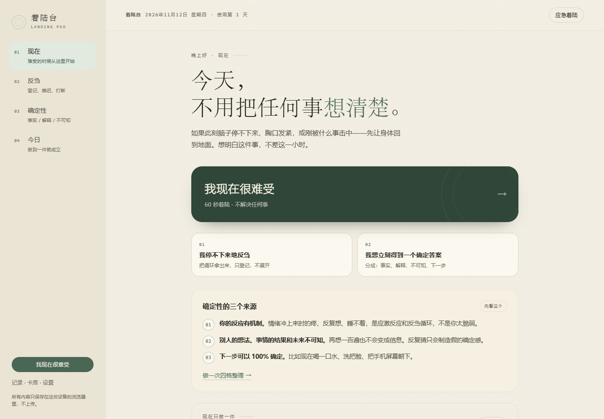

# 着陆台 · Landing Pad

本地、离线、无账号的中文情绪危机自助小工具。当前版本 **0.2.0**。

情绪冲上来、脑子反复播放同一段的时候，先用 60 秒把身体拉回地面；缓过来之后，再用几张纸面工具把混在一起的东西分开。

> 不是医疗器械，不替代心理咨询或精神科诊疗。
> 有伤害自己的念头：**12356**（全国心理援助热线）· **120 / 110**（紧急）。
> 不在中国大陆：拨打当地紧急电话，或在 [findahelpline.com](https://findahelpline.com) 查找本地热线。

## 使用

**在线版（PWA，可装到主屏 / 桌面）**：把仓库根目录部署到任意 HTTPS 静态托管（Cloudflare Pages、Netlify、Vercel 等），打开网址后按提示安装。仓库根目录已包含 PWA 需要的 `manifest.webmanifest`、`sw.js` 和 `icons/`。

- iPhone / iPad：用 Safari 打开 → 点「分享」→「添加到主屏幕」
- Android：用 Chrome 打开 → 右上角菜单 →「安装应用」/「添加到主屏幕」
- 电脑：Chrome / Edge 点地址栏右侧的安装图标

装好后从图标打开：全屏、离线可用，数据仍然只存在本机。

**单文件版**：下载 [`index.html`](https://github.com/erphenheimer/zhuolu/releases/latest/download/index.html)，双击用浏览器打开。不用联网，不用安装。想打印随身卡片，可打印 [`口袋卡.pdf`](口袋卡.pdf)。



## 有什么

- **我现在很难受**：60 秒着陆（呼吸 5 轮 → 5-4-3-2-1 → 记录强度与此刻需要什么）
- **反刍**：写下循环的那句话，得到一句针对性回应，存进盒子，留到担忧窗口
- **确定性**：四格分开「已确定的事实 / 我的解释 / 不可知 / 下一步」
- **今日**：低标准小事、5 分钟启动、睡前 3 行、7 天打卡
- **更多**：心理教育卡、思维记录、支持网、危机资源、导出 / 导入备份

## 数据

记录只保存在当前浏览器的本地存储（localStorage，键 `zhuolu.v1`），不上传、不联网、没有账号。

- 主屏应用和 Safari 的存储是分开的：固定从一个入口打开。
- 换设备、清理浏览器数据前，先在「更多 → 导出 JSON」备份。
- 导出的 JSON 带 `schemaVersion` 和导出时间；导入时会先预览条数，可选「合并」或「覆盖」。
- 页面会申请浏览器持久化存储；即使申请成功，定期导出仍然是最可靠的备份。

## 边界

方法来自 CBT / ACT 中常见的自助技术：情绪命名、延长呼气、接地、担忧推迟、行为激活、思维记录。自助练习不等于治疗。

如果已被诊断为焦虑障碍、适应障碍或其他精神科问题，这个工具最多是日常辅助，治疗计划请跟医生 / 咨询师走。持续两周以上情绪低落或焦虑、睡眠明显受损、无法学习工作、回避越来越多，请优先寻求专业帮助。

## 开发

```bash
node build.mjs   # 把 src/ 合成单文件 index.html
```

`index.html` 是生成物，不要直接改；改 `src/` 下的源文件。在线安装版还需要同目录的 `manifest.webmanifest`、`sw.js` 和 `icons/`。配色与设计变量在 `src/style.css` 顶部。

## 版本

0.2.0 完成 PWA 化（可安装、离线、iOS 安全区适配）与导出 / 导入接续。1.0 留给真正能「本地运行、长期记录、导出导入接续」的独立软件，计划见 [ROADMAP.md](ROADMAP.md)。

## 许可

[MIT](LICENSE)。按「现状」提供，不构成医疗建议。

---

**English**: Landing Pad is a single-file, offline, account-free Chinese self-help tool for emotional crises, rumination and anxiety. It can also be deployed as an installable PWA (iOS/Android/desktop) on any HTTPS static host. No network requests, no analytics, data stays in your browser. Not a medical device; does not replace professional care.
